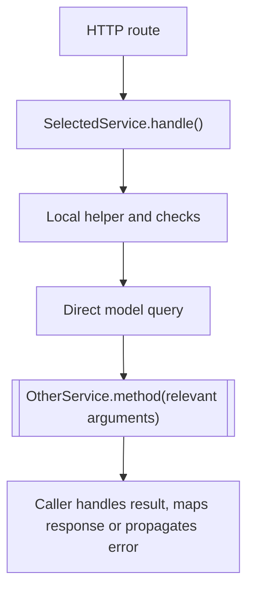

# Architecture docs with service boundaries

Produce implementation-backed architecture documentation at the depth established
by the SuperPay Open API example. Preserve existing detail during updates. The
output is local Markdown with Mermaid diagrams; an endpoint-bearing feature also
gets a self-contained contract-sync document.

## Select the source and destination

- Read the repository instructions and relevant architecture/API rules. Respect
  the user's selected branch, commits, feature and output location.
- Check branch, HEAD and local changes before reading implementation. If the
  requested revision differs, use `git show <revision>:<path>` or switch when
  authorized; do not silently document another checkout. Do not discard changes.
- State the source revision and scope in the architecture document. Distinguish a
  commit snapshot from current behavior; do not present historical code as current.
- Reuse an existing destination; otherwise use
  `docs/<feature>/<feature>-architecture.md` and, for routes,
  `docs/<feature>/<feature>-contract-sync.md`.
- Check ignore rules and nested instructions. An ignored docs directory does not
  authorize changing `.gitignore`, staging, committing or publishing. Report the
  ignored status if it affects reviewability.

## Preserve detail when updating

Read the whole existing document and save a comparison baseline before editing.
Keep accurate diagrams, method-level branches, query details and examples. Update
obsolete names and behavior in place; add detail alongside overview sections.
Remove content only when it no longer applies to the selected implementation,
and explain material removals in the completion report. Do not replace a deep
reference with a shorter overview or duplicate contradictory old behavior.

Inventory the selected controllers, root service methods, local helpers, mappers,
DTOs and relevant models before writing. Reconcile the final docs against that
inventory so a helper, endpoint or error branch does not disappear during a rewrite.

## Enforce the service-call boundary

A route's directly delegated service method, or a method explicitly selected by
the user, is a documentation root. Expand its own control flow, private helpers,
local pure functions and response mapping.

**A call to another service is a terminal node.** Show the service/method name,
relevant arguments, awaited return value and how the caller handles it. Do not
recursively diagram or narrate the callee's implementation, even if it lives in
the same module. Read a signature/type if needed to establish the boundary, but
do not infer downstream guarantees. If another service is independently a root
for a different route, document it in its own section and link to that section.
Only expand across a boundary when the user explicitly requests that scope.

Use double-bordered Mermaid nodes for these calls. Direct ORM calls in the
selected service remain in scope: show their predicates, associations, writes
and transaction options. A module dependency is not proof of a runtime call.

## Write architecture at two levels

Keep an overview for orientation, followed by a detailed reference. Scale the
number of diagrams to the real branches rather than a diagram-count target.

Cover these where present:

- **Wiring:** module registration, controller-to-service delegation, injected
  models, collaborators, helper/mapping dependencies, and explicit scope boundaries.
- **Entry and exit:** route prefix, authentication/authorization metadata, feature
  gates, parameter/DTO validation, response interceptors and error shaping.
- **Each root method:** input, checks in execution order, early returns, all local
  branches, other-service leaves, local writes, returned shape and error propagation.
- **Queries:** exact tenant/source/type/state predicates, selected columns,
  required/optional and separate associations, count query, ordering/tie breakers,
  defaults, filters ignored/overridden, date boundaries and pagination behavior.
- **Helpers:** caller, inputs, decision rules, fallback order, null handling,
  mutations and error codes. Use per-helper tables plus branch diagrams where useful.
- **Writes and recovery:** transaction scope, row locks versus conditional writes,
  prechecks versus atomic checks, replay keys, actual DB enforcement, race re-reads,
  rollback boundary, post-commit reads and side effects. State what is implemented;
  do not label a lookup-before-insert atomic or assume downstream idempotency.
- **State:** stored versus derived states, prerequisite matrices, enum mappings,
  allowed/rejected transitions, retry/replay behavior, IDs and persistence locations.
- **Mappers:** class/public/private structure, input interfaces and associations,
  helper-by-helper behavior, output fields, enum lookups, selection/deduplication,
  masking, date/money precision, null/omission rules and pure edit-field mappings.
- **Evidence:** source links and actual error catalogue values. When comments or
  Swagger disagree with implementation, describe the actual behavior and identify
  the discrepancy. Keep documentation work separate from fixes to application code.

Retain important distinctions: list eligibility versus detail visibility versus
mutation readiness; mapping ID versus entity ID; API-created source versus broad
read sources; public state versus stored state; and standalone versus embedded
response behavior. Do not silently smooth inconsistencies into an ideal contract.

## Add endpoint contracts whenever routes are involved

Read [references/endpoint-contracts.md](references/endpoint-contracts.md) when any
HTTP endpoint belongs to the documented scope. Create or update the companion
`<feature>-contract-sync.md` during the same task, not as a proposed follow-up.
List every relevant endpoint and provide expected requests and responses, not
just instructions for another agent to synchronize a remote document.

Architecture explains how the implementation works. The companion describes the
wire contract: methods, paths, parameters, bodies, statuses, envelopes, fields,
nullability, examples and errors. Link the documents. If an existing contract-sync
file also contains an external-editing workflow, retain it as a clearly separate
section; its presence does not authorize external edits or publishing.

For non-HTTP work, state that no endpoint contract applies; do not invent routes.

## Validate and deliver

- Compare source inventory with the final documents: every selected root/helper
  and every relevant route must be accounted for. Compare with the saved baseline
  to detect accidental loss of prior detail; line count alone is not evidence.
- Check links and anchors against the selected revision. Explain when links point
  to historical files that are absent from the current checkout.
- Validate Mermaid with an available parser/renderer. A fence or formatting check
  is not a grammar check; grammar success is not a rendering/layout check. State
  any unavailable validation honestly. Keep labels quoted in flowchart nodes;
  avoid semicolons in state-transition labels because they can terminate statements.
- Format the edited files. Validate contract JSON examples and, if using TypeScript
  shapes, check their combined definitions for missing references or syntax errors.
- Run the repository-required checks without changing their scope. In this repo,
  run lint, typecheck and build; documentation-only changes have no applicable
  Jest tests. Never run the full suite. If service/spec code was also authorized
  and changed, run only explicit relevant spec paths with `--runInBand`.
- Report document links, meaningful additions/behavior changes, source revision,
  checks and limitations. Never claim a successful check that did not run, and do
  not commit or push unless requested.
