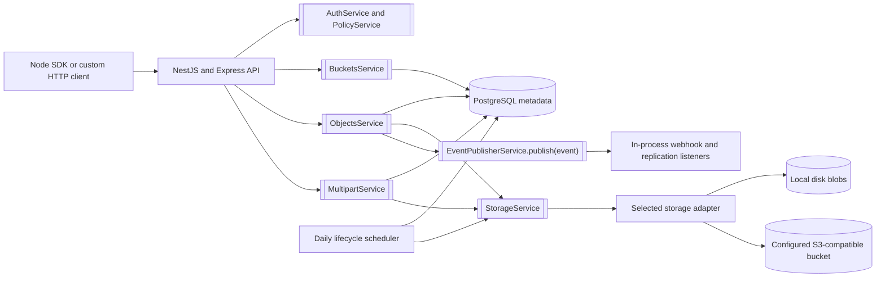
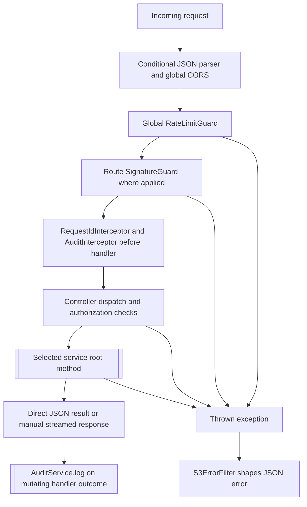
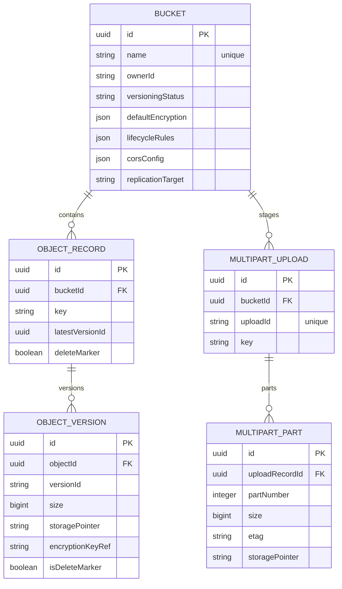
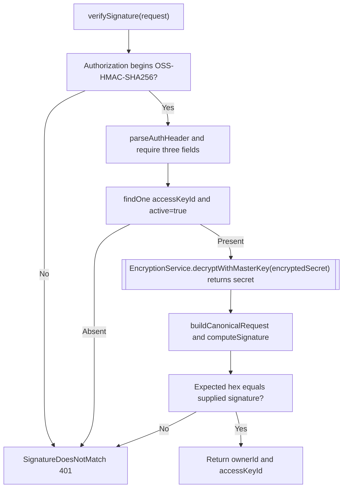
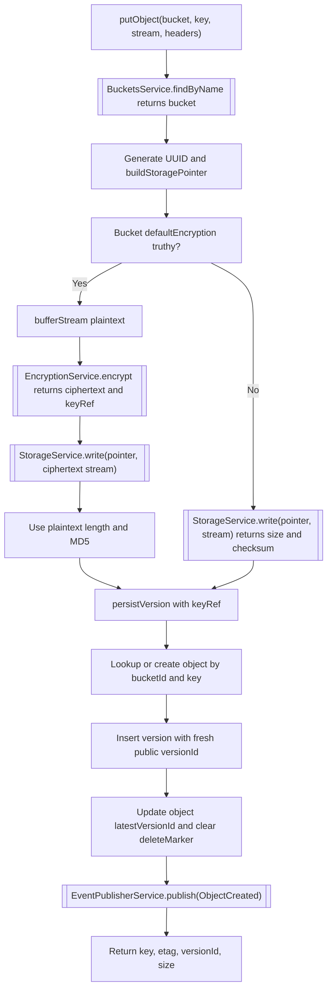
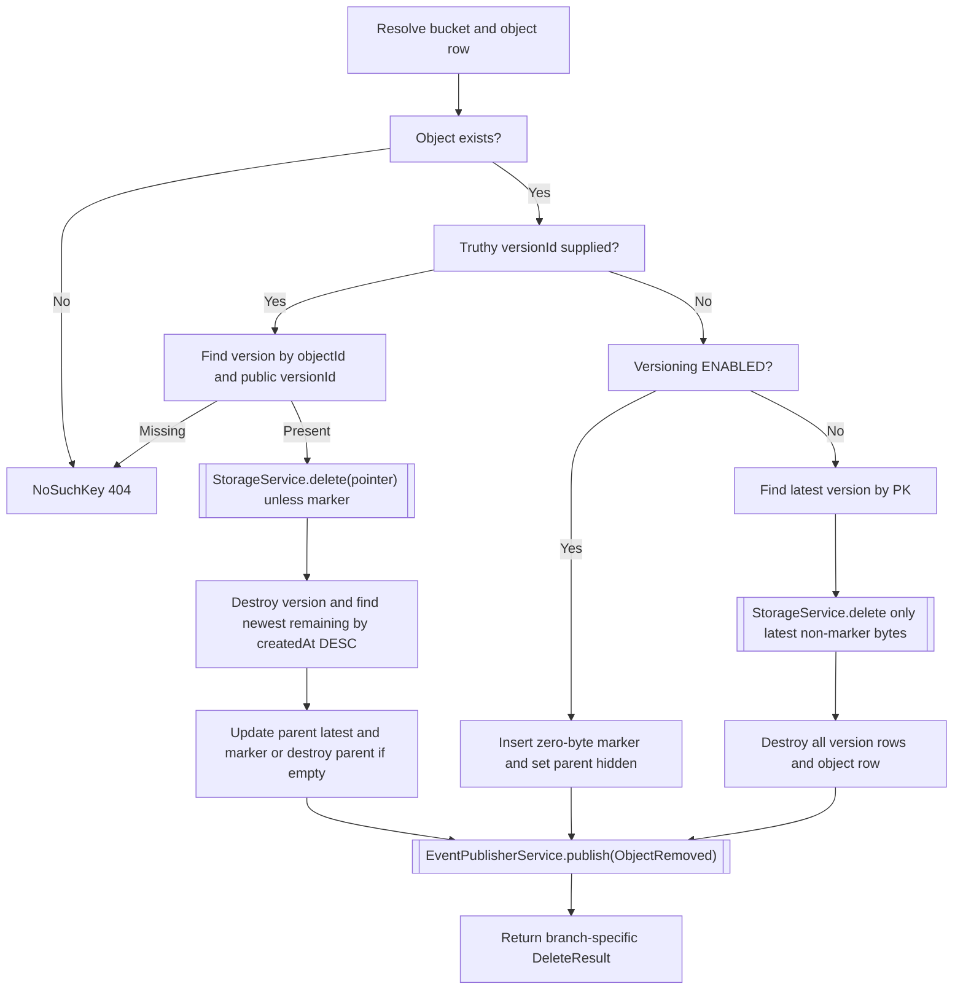
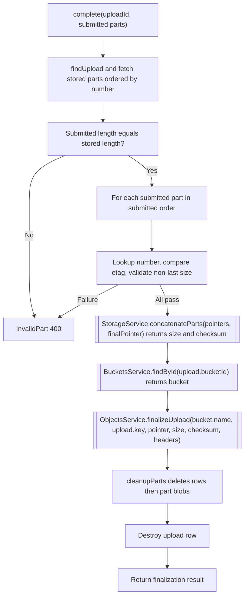
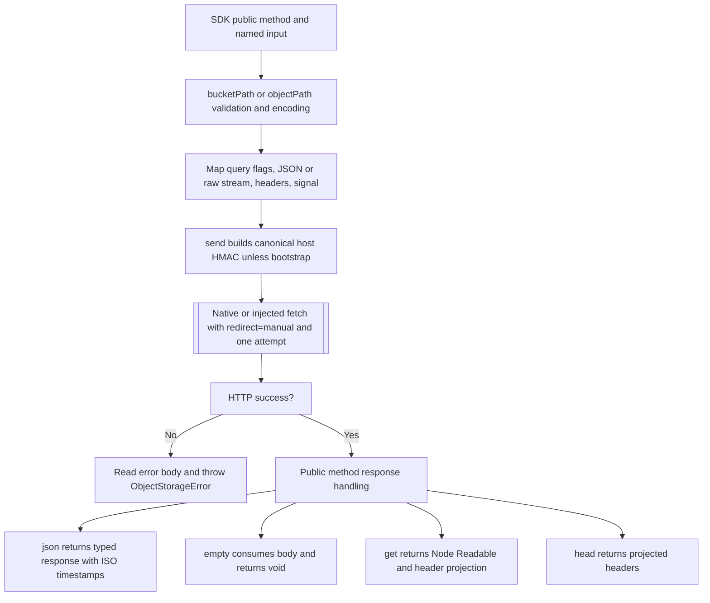

# Object Storage Service architecture

This document describes the **current working tree**, read on 13 November 2026, on branch `master` at base commit `80b38457d75bdcaa92a1dcf63ad72bde673d8c70`, including the SDK and server fixes made in this task. It is not a pristine commit snapshot. The base already includes NestJS 12 dependencies, Swagger, and compiler configuration; this working tree additionally changes object routing, raw JSON PUT handling, multipart replacement, presigned-method enforcement, and adds `packages/sdk/` with focused tests.

Scope: the whole repository, including every HTTP dispatch variant, service method, local helper, persistence model, storage adapter, scheduled task, and event listener. The product is an HTTP API; there is no end-user application UI. See the [usage guide](USAGE-GUIDE.md) for operation and runnable client examples and the [contract companion](API-CONTRACT-SYNC.md) for complete request/response contracts.

**Runtime verification:** object routes use Express 5 named wildcards `/:bucket/*key`; the signature guard joins their decoded segment arrays into a key string. Focused tests start the real Nest controllers, Swagger discovery, guards, and middleware on a loopback HTTP server and exercise the SDK. Metadata services/models use in-memory fixtures; no live PostgreSQL or upstream S3 startup was tested. The legacy `:key(*)` registration blocker is fixed.

## Contents

- [System overview](#system-overview)
- [Startup and request execution](#startup-and-request-execution)
- [Modules and dependency injection](#modules-and-dependency-injection)
- [Persistence and identifiers](#persistence-and-identifiers)
- [Controller dispatch and authorization](#controller-dispatch-and-authorization)
- [Authentication reference](#authentication-reference)
- [Bucket service reference](#bucket-service-reference)
- [Object service reference](#object-service-reference)
- [Multipart service reference](#multipart-service-reference)
- [Access control and encryption reference](#access-control-and-encryption-reference)
- [Storage reference](#storage-reference)
- [Background work and audit](#background-work-and-audit)
- [Consistency, recovery, and operational limits](#consistency-recovery-and-operational-limits)
- [TypeScript SDK architecture](#typescript-sdk-architecture)
- [Source inventory and validation](#source-inventory-and-validation)

## System overview

The application is a NestJS/Express monolith with a metadata database and a replaceable byte store. PostgreSQL stores ownership, object/version identities, pointers, keys, policies, multipart state, notification settings, and audit outcomes. Object payloads live on local disk by default, or in one configured upstream S3-compatible bucket. Logical application buckets are metadata rows, not separate upstream buckets.

The API resembles S3's paths and query subresources but uses custom HMAC authentication and JSON responses. It does not implement AWS Signature Version 4, XML contracts, or the full S3 feature set. The AWS SDK dependency is used by the **backend adapter**, not as an implementation of the public API's authentication.

In method-level diagrams, double-bordered nodes are calls to another service. Such calls are terminal boundaries: their arguments, returned values, and caller handling are documented, while their internals appear in their own reference section. Direct ORM operations and same-service helper calls remain inside the root method's trace. Overview dependency arrows describe architecture, not an implied nested call sequence.

## Startup and request execution

Sources: [bootstrap](../src/main.ts), [AppModule](../src/app.module.ts), [configuration](../src/config/configuration.ts), [controlJsonMiddleware](../src/common/middleware/control-json.middleware.ts).

1. `bootstrap()` creates a `NestExpressApplication` with `bodyParser: false`.
2. `controlJsonMiddleware` leaves PUT bodies with paths matching `^/[^/]+/.+` as raw streams, including JSON object/part payloads. Other requests whose Content-Type contains `application/json` use `express.json({ limit: '10mb' })`; other media types pass through. Thus auth/config/tagging/completion JSON is parsed, while object PUT preserves the byte stream.
3. `enableCors()` installs global CORS behavior. Stored per-bucket CORS rules are not consulted by this middleware.
4. Swagger is configured at `/docs`, with specs at `/docs-json` and `/docs-yaml`, before `listen()`. These paths can shadow logical bucket names. The generated spec is not a complete description of query dispatch variants or manually streamed bodies.
5. `listen(process.env.PORT || 3000)` starts the API. The example environment sets `PORT=4000`; the fallback is 3000. The configured `port` property is not read by bootstrap.
6. `ConfigModule.forRoot` loads environment configuration globally. Sequelize uses `autoLoadModels: true` and `synchronize: true`; there is no migration runner. Both event emitter and scheduler initialize in this same process.

Route registration and Swagger discovery are exercised by focused HTTP integration tests with the installed dependencies. A full `AppModule` startup still requires the configured metadata database; these tests do not establish database connectivity or migration safety.

The diagram groups both global interceptors without promising their relative nesting. Guards execute before interceptors. Consequently, `RateLimitGuard` normally runs before `SignatureGuard` has attached `request.principal`, so its effective limiter key is the request IP. Authentication/rate-limit rejections occur before request-ID assignment and audit interception; their error bodies can omit `requestId`, and they do not produce audit rows through this interceptor.

### Cross-cutting helpers

| Component                        | Exact behavior                                                                                                                                                                                                                                                                                                                                                                                                          |
| -------------------------------- | ----------------------------------------------------------------------------------------------------------------------------------------------------------------------------------------------------------------------------------------------------------------------------------------------------------------------------------------------------------------------------------------------------------------------- |
| `RateLimitGuard.canActivate`     | Per-process map keyed by existing access-key principal, otherwise IP, otherwise `anonymous`. New bucket: 100 tokens. Refill: elapsed seconds × 20, capped at 100. Fewer than one token throws HTTP 429; otherwise subtract one. Entries never evict. No shared limit across replicas.                                                                                                                                   |
| `SignatureGuard.canActivate`     | Join Express wildcard `params.key` arrays using slash before authentication. Truthy query signature calls `PresignedUrlService.verify(bucket, key or empty string, query, request.method)` and attaches principal. Otherwise await `AuthService.verifySignature({ method, path, query, headers })`. Bad presign does not fall back to header authentication.                                                            |
| `CurrentPrincipal`               | Returns `request.principal`; no identity lookup, normalization, or role derivation.                                                                                                                                                                                                                                                                                                                                     |
| `RequestIdInterceptor.intercept` | Reuse `x-request-id` or generate `randomUUID()`, assign `request.requestId`, set response `x-request-id`, and continue. It is not middleware and cannot stamp failures that precede it.                                                                                                                                                                                                                                 |
| `S3ErrorFilter.catch`            | `S3Exception`: use its status/code/message. Other `HttpException`: code is `HttpStatus[status]`, message from response body/string, and arrays joined with `; `. Other `Error`: log stack and expose `error.message` with status 500/code `InternalError`. Unknown values use `An internal error occurred`. Output is `{ error: { code, message, requestId } }`; undefined request ID is omitted by JSON serialization. |

There is **no global or route `ValidationPipe`**, no DTO transformation, no success-envelope interceptor, and no feature-flag system. Class-validator decorators document intended DTO inputs but do not reject or convert incoming values. In particular, query strings are not numbers merely because an interface says `number`.

## Modules and dependency injection

All ten feature modules are imported by `AppModule`. Module imports provide availability; the table separately identifies actual injected collaborators.

| Module                | Registered models                  | Controllers/providers and runtime dependencies                                                                                                                                     |
| --------------------- | ---------------------------------- | ---------------------------------------------------------------------------------------------------------------------------------------------------------------------------------- |
| `AuthModule`          | `AccessKey`                        | `AuthController`, `AuthService` → encryption, `SignatureGuard` → auth/presign. Exports auth service and guard.                                                                     |
| `AccessControlModule` | `Policy`                           | `PolicyService`, `EncryptionService`, `PresignedUrlService`; exports all three. Config is globally available.                                                                      |
| `BucketsModule`       | `Bucket`, `ObjectRecord`           | `BucketsController` → buckets/policy/objects; `BucketsService` → registered models. Exports buckets service.                                                                       |
| `ObjectsModule`       | `ObjectRecord`, `ObjectVersion`    | `ObjectsController` → objects/buckets/multipart/policy/presign; `ObjectsService` → models/buckets/storage/encryption/events. Exports objects service.                              |
| `MultipartModule`     | `MultipartUpload`, `MultipartPart` | No controller; `MultipartService` → models/buckets/objects/storage. Exports multipart service.                                                                                     |
| `StorageModule`       | None                               | Both adapters are providers. `STORAGE_ADAPTER` factory selects S3 only when `storage.adapter === 's3'`, otherwise local. `StorageService` delegates to that token and is exported. |
| `NotificationsModule` | `NotificationConfig`               | `EventPublisherService` and `WebhookDispatcher`; exports publisher.                                                                                                                |
| `ReplicationModule`   | None                               | `ReplicationListener` → buckets/replication; `ReplicationService` → objects. Exports replication service.                                                                          |
| `LifecycleModule`     | `ObjectRecord`, `ObjectVersion`    | `LifecycleScheduler` → buckets/lifecycle; `LifecycleService` → models/storage. Exports lifecycle service.                                                                          |
| `AuditModule`         | `AuditLog`                         | `AuditService` and a global `APP_INTERCEPTOR` binding for `AuditInterceptor`. Exports audit service.                                                                               |

`BucketsModule ↔ ObjectsModule` and `ObjectsModule ↔ MultipartModule`, plus multipart's buckets import, use `forwardRef()` at module boundaries. Corresponding constructor cycles use `@Inject(forwardRef(...))` where declared. Multipart routes belong to `ObjectsController` because Nest routes on method/path, not query parameters. There is no separate multipart controller.

## Persistence and identifiers

All models use `timestamps: true`, giving `createdAt`/`updatedAt`. UUID primary keys default to UUIDv4. JSON configuration is stored directly; there is no domain mapper for returned bucket, policy, or multipart-part model instances.

The quoted `"unique"` labels are attribute comments, used instead of the `UK` marker for compatibility with Mermaid 9.2.2. The actual unique constraints are described in the table below.

The diagram's multipart bucket relationship reflects `@ForeignKey(() => Bucket)`; the upload model has no `@BelongsTo` bucket accessor. Do not infer additional associations or cascade options beyond decorators: application code does not explicitly configure deletion cascades or transaction options.

| Table/source                                                                        | Fields, defaults, constraints, and associations                                                                                                                                                                                                                                                                                     |
| ----------------------------------------------------------------------------------- | ----------------------------------------------------------------------------------------------------------------------------------------------------------------------------------------------------------------------------------------------------------------------------------------------------------------------------------- |
| [buckets](../src/buckets/entities/bucket.entity.ts)                                 | `name` globally unique and non-null; `region`/`ownerId` non-null; `versioningStatus` enum `DISABLED` (default), `ENABLED`, `SUSPENDED`; nullable JSON `defaultEncryption`, `lifecycleRules`, `corsConfig`; nullable `replicationTarget` bucket name. `HasMany(ObjectRecord)`.                                                       |
| [objects](../src/objects/entities/object.entity.ts)                                 | Non-null bucket FK/key, unique composite `(bucketId, key)`; nullable `latestVersionId`; `deleteMarker=false`. `BelongsTo(Bucket)` and `HasMany(ObjectVersion)`. `latestVersionId` is a UUID column, **not a declared FK**.                                                                                                          |
| [object_versions](../src/objects/entities/object.entity.ts)                         | Object FK; public `versionId` string (no unique constraint); non-null `BIGINT size`, `checksum`, `storagePointer`; storage class `STANDARD` (default), `INFREQUENT_ACCESS`, `ARCHIVE`; `contentType` defaults octet-stream; nullable `userMetadata`, `tags`, `encryptionKeyRef`; `isDeleteMarker=false`. `BelongsTo(ObjectRecord)`. |
| [access_keys](../src/auth/entities/access-key.entity.ts)                            | Non-null owner, globally unique non-null `accessKeyId`, encrypted secret text, `active=true`. Secret is encrypted because signature verification needs reversible key material.                                                                                                                                                     |
| [policies](../src/access-control/entities/policy.entity.ts)                         | Bucket **name**, principal, action, resource pattern all non-null; effect enum `ALLOW` (default)/`DENY`. No bucket FK or uniqueness across statements.                                                                                                                                                                              |
| [multipart_uploads](../src/multipart/entities/multipart-upload.entity.ts)           | Bucket FK, key, unique public `uploadId`, nullable content type; `HasMany(MultipartPart)`. No explicit upload status column. Existence means open.                                                                                                                                                                                  |
| [multipart_parts](../src/multipart/entities/multipart-upload.entity.ts)             | Upload-record FK; integer part number; non-null etag/size/pointer; unique `(uploadRecordId, partNumber)`; `BelongsTo(MultipartUpload)`.                                                                                                                                                                                             |
| [notification_configs](../src/notifications/entities/notification-config.entity.ts) | Non-null bucket **name**, JSON events array, webhook URL. No bucket FK or configuration HTTP endpoint.                                                                                                                                                                                                                              |
| [audit_logs](../src/audit/entities/audit-log.entity.ts)                             | Non-null actor/action/resource; result enum `SUCCESS`, `DENIED`, `ERROR`; nullable request ID. No public query route.                                                                                                                                                                                                               |

Three identifiers must remain distinct: `ObjectVersion.id` is the internal database PK, `ObjectRecord.latestVersionId` references that PK by convention, and HTTP `versionId` uses `ObjectVersion.versionId`. Storage pointers are hashes of inputs and are neither of those IDs. `putObject` generates a UUID for its pointer, then `persistVersion` generates a **different UUID** for the public version. Multipart final pointers derive from the upload ID. Policy principals use owner IDs, not access-key IDs.

Stored `deleteMarker` on the object is a cached visibility flag; per-version `isDeleteMarker` identifies a marker row. `isLatest` is derived by comparing version PK against `latestVersionId`. PostgreSQL `BIGINT` values can serialize as decimal strings because there is no numeric conversion in entity responses or metadata mapping.

## Controller dispatch and authorization

Sources: [AuthController](../src/auth/auth.controller.ts), [BucketsController](../src/buckets/buckets.controller.ts), [ObjectsController](../src/objects/objects.controller.ts).

Controller method inventory: `AuthController.createAccessKey` and `revokeAccessKey`; `BucketsController.putBucket`, `listBuckets`, `getBucketConfig`, and `deleteBucket`; `ObjectsController.putObject`, `getObject`, `deleteObject`, and `postObjectSubresource`. The dispatch table follows these handlers; their local helpers are expanded separately below.

There is no global API prefix. Bucket/object controllers require `SignatureGuard`; bootstrap does not. Every branch below is listed independently in the [contract index](API-CONTRACT-SYNC.md#endpoint-index).

| Handler                  | Dispatch order and directly delegated roots                                                                                                                                                                                                                                                                                                |
| ------------------------ | ------------------------------------------------------------------------------------------------------------------------------------------------------------------------------------------------------------------------------------------------------------------------------------------------------------------------------------------ |
| Auth POST                | `/auth/keys` → `generateAccessKey(dto.ownerId)`.                                                                                                                                                                                                                                                                                           |
| Auth DELETE              | `/auth/keys/:accessKeyId` → `revokeAccessKey(id, principal)` after signature guard.                                                                                                                                                                                                                                                        |
| Bucket PUT               | First present flag wins: `policy` → owner check + `attachBucketPolicy`; `versioning` → owner + `setVersioning`; `lifecycle` → owner + `setLifecycleRules`; `encryption` → owner + `setEncryptionDefault`; `cors` → owner + `setCors`; fallback → `create(name, body, principal.ownerId)`.                                                  |
| Root GET                 | `list(principal.ownerId)`. Root privilege does not broaden this query.                                                                                                                                                                                                                                                                     |
| Bucket GET/implicit HEAD | `policy` → owner + `getEffectivePolicy`; `versioning`/`lifecycle`/`encryption`/`cors` → `findByName`, then project stored config; `versions` → `listObjectVersions(bucket, prefix)`; fallback → `listObjects(bucket, query)`. Only policy branch checks ownership.                                                                         |
| Bucket DELETE            | Owner check → `delete(bucket)`.                                                                                                                                                                                                                                                                                                            |
| Object PUT               | Authorize `PutObject` first. Both `uploadId` and `partNumber` present → `storePart`; otherwise `x-amz-copy-source` truthy → authorize source `GetObject`, then `copyObject`; fallback → `putObject` with content type and collected `x-amz-meta-*`.                                                                                        |
| Object GET/HEAD          | First `uploadId` → authorize `PutObject`, `listParts`, JSON parts wrapper; then `presign` → authorize `PutObject` for PUT links, otherwise `GetObject`, then `generate` validates GET/PUT; then `tagging` → authorize `GetObjectTagging`, `getTags`; otherwise authorize `GetObject`, HEAD → `getObjectMetadata`, GET → `getObjectStream`. |
| Object DELETE            | Present `uploadId` → authorize `PutObject`, `abort`, return `{}`; otherwise authorize `DeleteObject`, `deleteObject(bucket, key, versionId)`.                                                                                                                                                                                              |
| Object POST              | Present `uploads` → authorize `PutObject`, `initiate`; else `uploadId` → authorize `PutObject`, `complete`; else `tagging` → authorize `PutObjectTagging`, `setTags`, `{}`; otherwise HTTP 403 `Unsupported object subresource`. All POST success statuses default to 201.                                                                 |

### Controller-local helpers

| Helper                          | Inputs, calls, branches, and output                                                                                                                                                                                                                                       |
| ------------------------------- | ------------------------------------------------------------------------------------------------------------------------------------------------------------------------------------------------------------------------------------------------------------------------- |
| `BucketsController.assertOwner` | Await `BucketsService.findByName(bucketName)`; allow root or matching `ownerId`, otherwise throw `ForbiddenException('Only the bucket owner can perform this action')`. No policy evaluation.                                                                             |
| `ObjectsController.authorize`   | Await `BucketsService.findByName(bucket)`; await `PolicyService.evaluate(principal, action, bucket + '/' + key, ownerId)`; false throws `ForbiddenException('Not authorized to ACTION on BUCKET/KEY')`. Each service call is a terminal boundary.                         |
| `ObjectsController.parseRange`  | Missing string → undefined. Unanchored regex `/bytes=(\d+)-(\d+)?/`; no match → undefined, not 416. Match → numbers, with absent end = `Number.MAX_SAFE_INTEGER`. No suffix/multi-range implementation, ordering/bounds check, or length clamp.                           |
| Object upload header collection | Select header names beginning `x-amz-meta-`, remove prefix, preserve values; empty result becomes undefined. Copy source removes one leading slash, splits on `/`, first segment bucket, remainder key; there is no URI decoding or source-version parsing here.          |
| Object GET response mapping     | HEAD sets length, type, raw checksum ETag and public version ID; no metadata headers/Last-Modified. GET sets type, ETag and version ID, chooses 206 whenever `parseRange` returned a range, and pipes stream. It does not set Content-Range or Content-Length explicitly. |

Config reads (except policy), object listings, and version listings do not evaluate object policies or bucket ownership. Any authenticated principal can reach those branches for a known bucket. Multipart actions authorize the **URL's** bucket/key, then lookup upload by ID alone: the controller/service do not verify that the ID belongs to that URL resource.

## Authentication reference

Source: [AuthService](../src/auth/auth.service.ts). Registered model: `AccessKey`; collaborator boundary: `EncryptionService`.

### `generateAccessKey(ownerId)`

Generate `AKIA` + 8 random bytes as uppercase hex and a 24-random-byte base64url secret. Call synchronous `EncryptionService.encryptWithMasterKey(secret)`; persist `{ ownerId, accessKeyId, secretKeyEncrypted, active: true }`; return only `{ accessKeyId, secretKey }`. There is no prior identity verification or owner existence check, no root-role assignment, and no key-list/recovery endpoint. Unique collisions propagate as ORM errors; no retry is implemented.

### `revokeAccessKey(accessKeyId, requester)`

`findOne({ where: { accessKeyId } })`; missing → successful void. Existing row requires matching owner or `isRoot`, otherwise `AccessDenied` 403 with `Cannot revoke an access key you do not own`. Update `active=false`, returning void. Repeating with another active key is harmless; trying to authenticate using the just-revoked key fails before this method.

### `verifySignature(request)` and helpers

| Helper                  | Rules                                                                                                                                                                                                                                                                                                                                                                    |
| ----------------------- | ------------------------------------------------------------------------------------------------------------------------------------------------------------------------------------------------------------------------------------------------------------------------------------------------------------------------------------------------------------------------ |
| `parseAuthHeader`       | Strip scheme, split commas, trim entries, split each at `=`, build field map. Require `Credential`, `SignedHeaders`, `Signature`; missing values throw `Authorization header missing required fields`. Signed headers split at semicolon. No supported-header allowlist.                                                                                                 |
| `buildCanonicalRequest` | Sort query keys, join decoded parsed values as `k=v` using `&`; sort selected header names, map `name:trimmedValue` with missing headers treated as empty; join uppercase method, Express `request.path`, query text, header text, and semicolon-joined sorted names using newline characters. Sorting mutates the signed-header array. No URI re-encoding or body hash. |
| `computeSignature`      | HMAC-SHA256 using the raw per-key secret, output lowercase hex. Verification uses ordinary string inequality.                                                                                                                                                                                                                                                            |

Missing/wrong-scheme header → `Missing or malformed Authorization header`; absent/inactive key → `Unknown or inactive access key`; unequal signature → `The request signature could not be verified`. All are `SignatureDoesNotMatch`, HTTP 401. Decryption/DB failures propagate to the global filter. There is no timestamp, expiry, replay cache, signed body, or mandatory host-header rule for header signatures.

## Bucket service reference

Source: [BucketsService](../src/buckets/buckets.service.ts). This service directly uses `Bucket` and `ObjectRecord`; it makes no calls to another service.

| Root or helper                       | Ordered execution and persistence                                                                                                                                                                                                                                                                         |
| ------------------------------------ | --------------------------------------------------------------------------------------------------------------------------------------------------------------------------------------------------------------------------------------------------------------------------------------------------------- |
| `create(name, dto, ownerId)`         | Call local `validateBucketName`; `Bucket.findOne` by name; present → `BucketAlreadyExists` 409; absent → create name, `dto.region`, owner. Return model. Lookup/create is not atomic, but a unique name constraint exists; concurrent loser gets an ORM failure rather than a guaranteed mapped conflict. |
| `findByName(name)`                   | `findOne({ where: { name } })`; missing → `NoSuchBucket` 404, else full model.                                                                                                                                                                                                                            |
| `findById(id)`                       | `findByPk(id)`; missing → same error with ID in message. Used to resolve multipart's bucket name.                                                                                                                                                                                                         |
| `list(ownerId)`                      | `findAll({ where: { ownerId } })`; no associations, projection, ordering, count, or pagination. Empty → `[]`.                                                                                                                                                                                             |
| `findAllWithLifecycleRules()`        | `findAll` with `lifecycleRules != null`; includes empty arrays. Scheduler entry, not HTTP.                                                                                                                                                                                                                |
| `delete(name)`                       | Local `findByName` → local `isEmpty(bucket.id)` → nonempty throws `BucketNotEmpty` 409 → destroy bucket. Only object rows are counted; open multipart sessions, policies, and notification settings are not checked or explicitly removed.                                                                |
| `validateBucketName(name)`           | Length 3–63, then `/^[a-z0-9]([a-z0-9-]{1,61}[a-z0-9])?$/`, then reject IPv4-like `/^\d+\.\d+\.\d+\.\d+$/`. Dots already fail the preceding regex. Exact reason text is in the [error catalogue](API-CONTRACT-SYNC.md#error-catalogue).                                                                   |
| `setVersioning(name, status)`        | Local `findByName`, then update `versioningStatus`; return full updated bucket. It does not inspect/rewrite existing versions. Type expects ENABLED/SUSPENDED but there is no runtime DTO enforcement.                                                                                                    |
| `setLifecycleRules(name, rules)`     | Local lookup then replace `lifecycleRules` JSON with supplied array, return bucket. Empty array disables effective rules; no merge by rule ID.                                                                                                                                                            |
| `setEncryptionDefault(name, config)` | Local lookup then replace `defaultEncryption`, return bucket. No key-provider check or existing-byte rewrite.                                                                                                                                                                                             |
| `setCors(name, rules)`               | Local lookup then replace `corsConfig`, return bucket. Does not configure Express CORS.                                                                                                                                                                                                                   |
| `isEmpty(bucketId)`                  | `ObjectRecord.count({ where: { bucketId } }) === 0`; includes hidden objects/delete markers. No locks or transactional linkage to deletion.                                                                                                                                                               |

## Object service reference

Source: [ObjectsService](../src/objects/objects.service.ts). Models: `ObjectRecord`, `ObjectVersion`; collaborator calls to buckets/storage/encryption/events are terminal service boundaries. Same-service calls (`copyObject` → `putObject`, for example) expand as local control flow.

### `putObject` and `finalizeUpload`

`putObject(bucketName, key, stream, headers)` resolves bucket, creates pointer, and chooses buffered encryption only if `bucket.defaultEncryption` is truthy. Encrypted bytes are written before metadata; size/MD5 refer to plaintext and the storage write result is ignored. Without encryption it uses storage's returned size/checksum. Both branches call `persistVersion`.

`finalizeUpload(bucketName, key, pointer, size, checksum, headers)` resolves bucket and calls the same `persistVersion` with `encryptionKeyRef=null`. Bytes already exist. It **does not apply bucket default encryption** to completed multipart uploads.

`persistVersion` performs, in order:

1. `ObjectRecord.findOne` with exact `{ bucketId: bucket.id, key }`; create object if absent.
2. `ObjectVersion.create` with object PK, new public version UUID, size/checksum/pointer, `contentType = headers.contentType || 'application/octet-stream'`, `userMetadata = headers.userMetadata || null`, and encryption reference. Other model defaults supply storage class, marker flag, and nullable tags.
3. Update parent `{ latestVersionId: version.id, deleteMarker: false }`.
4. Await `EventPublisherService.publish({ type: 'ObjectCreated', bucketName, key, versionId: version.versionId, size })`.
5. Return `{ key, etag: checksum, versionId: version.versionId, size }`.

Every PUT creates a version regardless of `DISABLED`, `ENABLED`, or `SUSPENDED`; overwrite does not remove previous rows or bytes. There is no transaction, row lock, conditional latest-pointer update, replay key, failed-write cleanup, or duplicate-key race re-read.

### Reads and resolution

`resolveVersion(bucketName, key, versionId?)` calls `BucketsService.findByName`, queries object by bucket ID/key, then queries version by `{ objectId, versionId }` if a truthy public version ID is supplied, otherwise by the parent's latest **PK**. Missing object/version or `isDeleteMarker=true` → `NoSuchKey` 404. It does not use the cached parent marker flag for resolution. Explicit historical reads remain possible while latest is a marker.

`getObjectMetadata` returns `resolveVersion`'s full model internally; the controller emits only four headers. `getObjectStream` resolves the version, then:

- With `encryptionKeyRef`: await `StorageService.read(pointer)` without range; local `bufferStream`; await `EncryptionService.decrypt(ciphertext, keyRef)`; return a new plaintext `Readable` and the version. Requested range is ignored.
- Without reference: await `StorageService.read(pointer, range)`; return stream/version.

The controller still returns 206 for a parsed range on an encrypted object even though the body is the complete plaintext. Stream errors after the handler returns are not transformed into a guaranteed JSON error response by this design.

### `deleteObject(bucketName, key, versionId?)`

| Branch                         | Return and edge behavior                                                                                                                                                                                                                                                                                                                                  |
| ------------------------------ | --------------------------------------------------------------------------------------------------------------------------------------------------------------------------------------------------------------------------------------------------------------------------------------------------------------------------------------------------------- |
| Explicit version               | Delete its blob unless marker, destroy row, find remaining version `order: [['createdAt','DESC']]` without tie breaker. If present, update latest PK and cached marker even if deleted version was not latest; otherwise destroy object. Publish supplied version ID. Return `{ key, deleteMarker: false, versionId }`, including when deleting a marker. |
| No version, ENABLED            | Create marker with size 0, checksum/pointer empty, fresh public ID, `isDeleteMarker=true`; update parent latest PK/marker; publish marker ID. Return `{ key, deleteMarker: true, versionId: marker.versionId }`. Repeated delete creates more markers if parent exists.                                                                                   |
| No version, DISABLED/SUSPENDED | Find latest by PK, delete **only latest** blob if not marker, destroy all version rows by object ID, then parent. Publish latest public ID or empty string. Return `{ key, deleteMarker: false }` with no version ID. Older blobs can be orphaned.                                                                                                        |

### `listObjects(bucketName, opts)`

1. Await bucket lookup. `maxKeys = opts.maxKeys || 1000`; no maximum cap, validation, or coercion.
2. Base predicate `{ bucketId: bucket.id, deleteMarker: false }`. Truthy prefix adds `key LIKE prefix + '%'`; truthy marker adds `key > marker` alongside LIKE. SQL wildcard characters in prefix are not escaped.
3. Fetch full object rows, no association include, sorted `key ASC`, with `limit: maxKeys + 1`. No total-count query.
4. Derive truncation from raw rows, slice first `maxKeys` rows.
5. For each row: if delimiter occurs in key suffix after prefix, add grouped prefix to a `Set` and skip metadata lookup; otherwise `ObjectVersion.findByPk(latestVersionId)` and map when found. Missing latest versions are silently excluded.
6. Return bucket, optional echoed prefix/delimiter, truncation, `nextMarker` from last raw page row only when truncated, contents, insertion-ordered unique common prefixes. Undefined fields are omitted from JSON.

Pagination occurs **before** delimiter grouping, so contents plus common prefixes need not equal page size. The HTTP handler passes raw query strings: `maxKeys=2` becomes string `'2'`, so `maxKeys + 1` becomes `'21'` rather than 3. A local query-generation check produces SQL `LIMIT '21'`; response slicing/comparison separately coerce the supplied value. Thus numeric query strings inflate the lookahead fetch, while malformed values can fail or behave unexpectedly. No live database pagination check was run. Omit maxKeys to use the intended numeric default of 1000; no enforced maximum exists.

### `listObjectVersions(bucketName, prefix?)`

Await bucket lookup; object predicate is bucket ID plus optional unescaped `LIKE prefix%`, including hidden parents. `findAll({ where, include: [ObjectVersion], order: [['key','ASC']] })`; the include has no explicit `required`, selected columns, separate-query flag, or filtering. Sort each object's loaded versions by `createdAt` descending in JavaScript; flatten using `toMetadataDto` plus `isLatest` comparison against version PK and `isDeleteMarker`. No pagination, count, version-ID filter, or timestamp tie breaker. Empty → `{ bucket, versions: [] }`.

### Copy and tags

`copyObject(sourceBucket, sourceKey, destBucket, destKey)` locally resolves **latest** source version, calls `StorageService.read(sourceVersion.storagePointer)` directly, then local `putObject` with source content type and metadata. Return `{ etag, versionId, lastModified: new Date() }`. Tags and storage class are not copied. Because it bypasses `getObjectStream`, encrypted source bytes are copied as ciphertext; destination encryption can encrypt that ciphertext again and destination size/checksum describe those bytes. It is not a plaintext-preserving encrypted copy.

`setTags` resolves latest non-marker, updates `tags` as the supplied whole map, returns void. `getTags` resolves latest and returns stored tags or `{}`. Query `versionId` is ignored by both controller branches; there is no delete-tags route. Empty map clears tags. Omitted/malformed values are not normalized or validated.

### Local helpers and mapper inventory

| Helper                | Callers and rules                                                                                                                                                                                                                                                                                                                                    |
| --------------------- | ---------------------------------------------------------------------------------------------------------------------------------------------------------------------------------------------------------------------------------------------------------------------------------------------------------------------------------------------------- |
| `persistVersion`      | `putObject`, `finalizeUpload`; exact write/event sequence above.                                                                                                                                                                                                                                                                                     |
| `resolveVersion`      | Stream/metadata reads, copy, set/get tags; exact query and marker rejection above.                                                                                                                                                                                                                                                                   |
| `toMetadataDto`       | Object/version listings; pure projection to key, size, etag from checksum, content type, public version ID, storage class, lastModified from createdAt, userMetadata or empty map. No tags, encryption ref, pointer, internal IDs, masking, rounding, or numeric conversion. Dates serialize to ISO timestamps. Marker versions use same projection. |
| `buildStoragePointer` | `putObject`; SHA256 hex of `bucketId:key:generatedUUID`. It is not a content hash or public version ID.                                                                                                                                                                                                                                              |
| `bufferStream`        | Encrypted upload/download; collect chunks, then `Buffer.concat`, without a size cap. Assumes byte chunks.                                                                                                                                                                                                                                            |

## Multipart service reference

Source: [MultipartService](../src/multipart/multipart.service.ts). Models: uploads/parts. No transaction or explicit upload state machine; completion/abort remove the session row. Root methods are reached through object subresources.

| Root                                      | Ordered behavior and result                                                                                                                                                                                                                                                                                                                                                                                                                                                                                  |
| ----------------------------------------- | ------------------------------------------------------------------------------------------------------------------------------------------------------------------------------------------------------------------------------------------------------------------------------------------------------------------------------------------------------------------------------------------------------------------------------------------------------------------------------------------------------------ |
| `initiate(bucketName, key, contentType?)` | Await `BucketsService.findByName`; create upload with bucket ID, key, content type or null, and generated upload ID. Return `{ uploadId }`. No object row, retention timer, or encryption reference is created.                                                                                                                                                                                                                                                                                              |
| `storePart(uploadId, partNumber, stream)` | Local findUpload; generate a unique candidate pointer; await StorageService.write; find existing part by upload PK/number. Existing → save etag/size/new pointer, then delete previous blob. Absent → insert row. Return etag/size. On failure before acknowledged metadata save, attempt candidate-blob cleanup and rethrow original error; cleanup failure logs. After save, keep new pointer even if old cleanup fails. No part bounds, upload-time min-size check, transaction, or URL-resource binding. |
| `listParts(uploadId)`                     | Local upload lookup, then all parts by upload-record PK ordered `partNumber ASC`. Returns full ORM instances, not `PartInfoDto`, leaking internal PKs/pointers into this API response.                                                                                                                                                                                                                                                                                                                       |
| `abort(uploadId)`                         | Local lookup; fetch parts; parallel storage deletes; destroy all part rows by upload PK; destroy upload. Missing upload gives 404, so abort is not an idempotent no-op. Partial failure can leave a mixed state.                                                                                                                                                                                                                                                                                             |
| `complete(uploadId, parts)`               | Detailed trace below. Return the exact `PutObjectResultDto` from `ObjectsService.finalizeUpload`.                                                                                                                                                                                                                                                                                                                                                                                                            |

Part replacements now use a fresh UUID in the candidate pointer. This fixes the prior sequential retry bug that overwrote a deterministic pointer and then deleted those same bytes. The old row/blob remains available until replacement metadata saves. Cleanup of the old pointer follows publication; cleanup errors still propagate but do not delete the new pointer. There is no row lock or transaction: concurrent replacements can orphan a superseded candidate, ambiguous database failures have no replay journal, and overall multipart completion remains unsafe for automatic retries. The SDK performs no automatic retries.

`complete` compares submitted length against total stored parts, constructs a map by part number, and iterates the **submitted order**. It requires each number to exist and each etag to match; `validatePartSize` enforces 5 × 1024 × 1024 bytes except the final **submitted** entry. It does not enforce ascending order, consecutiveness, uniqueness, nonempty parts, or 10,000-part limits. Equal counts plus repeated submitted numbers can omit another stored part. Concatenation preserves submitted order. The final checksum is MD5 of concatenated bytes, not S3's multipart ETag convention.

The final pointer hashes `uploadId:part:final`. Finalization is awaited before cleanup. If finalization or cleanup fails, there is no rollback; bytes/versions may already exist and replay may produce additional versions or reuse an already published final pointer. Empty stored/submitted lists pass the length test and reach adapter concatenation.

| Local helper                             | Inputs, branches, effects                                                                                                                       |
| ---------------------------------------- | ----------------------------------------------------------------------------------------------------------------------------------------------- |
| `findUpload`                             | Query `{ uploadId }` only, no owner/bucket/key predicate. Missing → `NoSuchUpload` 404.                                                         |
| `validatePartSize(size, isLastPart)`     | Non-last and size below 5 MiB → `InvalidPart('All parts except the last must be at least 5MB')`. Otherwise no mutation.                         |
| `resolveBucketName(bucketId)`            | Await `BucketsService.findById`, return name; boundary exception propagates.                                                                    |
| `cleanupParts(uploadRecordId, pointers)` | Destroy all part rows first, then `Promise.all` storage deletes for submitted pointer list. It does not remove the final pointer.               |
| `buildPartPointer(uploadId, part)`       | SHA256 of `uploadId:part:partNumber:randomUUID()` for an individual write attempt; final concatenation remains SHA256 of `uploadId:part:final`. |

## Access control and encryption reference

### Policy service

Source: [PolicyService](../src/access-control/policy.service.ts). Direct `Policy` queries; no collaborator calls.

`evaluate(principal, action, resource, bucketOwnerId?)` returns true immediately for root or matching bucket owner, before policy lookup. Nonowners use `bucketName = resource.split('/')[0]` and fetch all policy rows by bucket name. Start `allowed=false`; skip rows whose principal, action, or resource fails. A matching `DENY` returns false immediately, otherwise matching rows set true. Return final boolean. Thus explicit DENY wins only for evaluated **nonowners**; owner/root bypass DENY. `'*'` principal still requires a successfully authenticated request at the controller guard.

`attachBucketPolicy(bucketName, policy)` destroys **all** existing statements by bucket name, then bulk-creates `policy.statements.map(...)`, defaulting missing/null `resourcePattern` to `bucketName + '/*'`. There is no transaction: failure after destroy loses the previous policy. Empty statements clears policy. `getEffectivePolicy` returns full rows by bucket name, with no projection/order, not an assembled `{ statements }` document.

| Local helper                           | Exact matching                                                                                                                                                                                                                                         |
| -------------------------------------- | ------------------------------------------------------------------------------------------------------------------------------------------------------------------------------------------------------------------------------------------------------ |
| `matchesPrincipal(pattern, principal)` | Literal `*` or exact `principal.ownerId`.                                                                                                                                                                                                              |
| `matchesAction(pattern, action)`       | Literal `*` or exact action. No action globbing, prefixes, or `s3:` aliases.                                                                                                                                                                           |
| `matchesResource(pattern, resource)`   | Split at `*`, escape each segment with `escapeRegex`, join `.*`, anchor with `^`/`$`, test. `*` can cross slashes.                                                                                                                                     |
| `escapeRegex(segment)`                 | Escape regex metacharacters (dot, plus, question mark, anchors, dollar, braces, parentheses, alternation, brackets, backslash); invoked by matchesResource as map callback, without state mutation. Asterisk is handled by the caller before escaping. |

Policies are keyed by reusable names and are not explicitly deleted with buckets. Recreating a name can pick up stale statements. There is no separate ListBucket permission evaluation in list controllers.

### Presigned URL service

Source: [PresignedUrlService](../src/access-control/presigned-url.service.ts).

`generate(bucket, key, method, expiresInSeconds, principal)` first rejects methods other than GET/PUT with `BadRequestException('Presigned method must be GET or PUT')`. Set expiry to floor(current epoch seconds) plus lifetime. Construct URLSearchParams in order method, expires, ownerId, accessKeyId; local sign HMACs the logical `bucket/key?params.toString()` using the global secret; append signature. Return a relative URL with bucket and each slash-separated key segment encoded using encodeURIComponent. Controller defaults empty method to GET and `Number(expiresIn)` falsy to 3600; server lifetime bounds remain absent.

`verify(bucket, key, query, requestMethod)` removes signature, recreates URLSearchParams in remaining query order, and verifies the HMAC. Then reject unsupported signed methods or a signed method unequal to uppercase requestMethod with `SignatureDoesNotMatch` 401, message `Presigned URL does not allow this HTTP method`. Next reject expired links. Return embedded owner/access-key IDs without database lookup or root role. `sign` is the only local helper. Path segments are decoded/joined by the guard before this call, matching generation's logical key.

GET links permit GET only; PUT links permit PUT only, including rejection of HEAD against a GET link. Generation checks the corresponding GetObject/PutObject action. Key revocation still does not invalidate existing links. Reordering/appending query parameters normally invalidates the HMAC. Object policy checks still run after verification; the link is an authenticated identity rather than an independent ACL grant.

### Encryption service

Source: [EncryptionService](../src/access-control/encryption.service.ts). Constructor hashes configured master-key text with SHA256 to exactly 32 bytes. AES-256-GCM payload layout: 12-byte random IV, 16-byte auth tag, ciphertext. No external KMS integration occurs; `_config`, including `algorithm` and `kmsKeyId`, is unused in `encrypt`.

| Method/helper                      | Behavior and call chain inside this service                                                                                                         |
| ---------------------------------- | --------------------------------------------------------------------------------------------------------------------------------------------------- |
| `generateDataKey()`                | Generate 32 random bytes, wrap using local `wrapWithMasterKey`, return plaintext key and wrapped string.                                            |
| `encrypt(buffer, config)`          | Local data-key generation, local `encryptWithKey(buffer, plaintextKey)`, return ciphertext and wrapped `keyRef`.                                    |
| `decrypt(ciphertext, keyRef)`      | Local `unwrapWithMasterKey`, then `decryptWithKey`, return plaintext buffer.                                                                        |
| `encryptWithMasterKey(plaintext)`  | Convert UTF-8 string to buffer and wrap directly; used for access-key secrets.                                                                      |
| `decryptWithMasterKey(ciphertext)` | Unwrap and convert UTF-8; errors propagate.                                                                                                         |
| `wrapWithMasterKey(plaintext)`     | Encrypt with normalized master key and base64-encode complete GCM payload.                                                                          |
| `unwrapWithMasterKey(wrapped)`     | Base64-decode and decrypt with normalized master key.                                                                                               |
| `encryptWithKey(plaintext, key)`   | Random IV, cipher update/final, concatenate IV/tag/encrypted bytes.                                                                                 |
| `decryptWithKey(payload, key)`     | Slice IV/tag/body, create decipher, set auth tag, concatenate update/final. Wrong key/tag or malformed data raises crypto error; no custom mapping. |

Rotating the one master string without rewrapping stored secrets/data keys breaks both existing header authentication and encrypted-object reads. There is no key ID/version persistence or rotation procedure in code.

## Storage reference

Sources: [StorageService](../src/storage/storage.service.ts), [adapter contract](../src/storage/adapters/storage-adapter.interface.ts), [local adapter](../src/storage/adapters/local-disk.adapter.ts), [S3 adapter](../src/storage/adapters/s3-compatible.adapter.ts).

`StorageService` is a facade: `write`, `read`, `delete`, `exists` forward arguments/results directly; `concatenateParts` delegates to adapter `concatenate`. Return `WriteResult` is `{ size, checksum }`; `ByteRange` is inclusive `{ start, end }`. The facade adds no retries, transaction coordination, encryption, pointer lookup, or error translation. The adapters are separately described roots for this repository-wide scope.

| Adapter method                       | Local disk implementation                                                                                                                                                                                                                                                                                             | S3-compatible implementation                                                                                                                                                                                                                                        |
| ------------------------------------ | --------------------------------------------------------------------------------------------------------------------------------------------------------------------------------------------------------------------------------------------------------------------------------------------------------------------- | ------------------------------------------------------------------------------------------------------------------------------------------------------------------------------------------------------------------------------------------------------------------- |
| Constructor                          | Root from configured storage.localRoot, otherwise `./data/blobs`.                                                                                                                                                                                                                                                     | S3 client with optional endpoint, default us-east-1 region, path-style when endpoint set, explicit credentials when access-key ID supplied, otherwise SDK defaults. One configured upstream bucket. Both adapter providers instantiate even when local is selected. |
| `write(pointer, stream)`             | Resolve path; recursive mkdir; hash MD5/count byte chunks from stream `data`; await pipeline to file; return length/hash. No temp file/rename/rollback.                                                                                                                                                               | Buffer all chunks while hashing, PutObject to upstream bucket/key=pointer, return buffer length/hash. No streaming upload or storage-class selection.                                                                                                               |
| `read(pointer, range?)`              | Return `createReadStream(path, {start,end})` if range. Missing-file errors may arrive after stream return.                                                                                                                                                                                                            | Await GetObject with `Range: bytes=start-end` if given, cast Body to Readable. Upstream failure propagates.                                                                                                                                                         |
| `delete(pointer)`                    | `unlink`; ignore only ENOENT.                                                                                                                                                                                                                                                                                         | Await DeleteObject.                                                                                                                                                                                                                                                 |
| `exists(pointer)`                    | Filesystem access; any exception → false.                                                                                                                                                                                                                                                                             | HeadObject; any exception → false, including permission/network errors.                                                                                                                                                                                             |
| `concatenate(pointers, destination)` | mkdir destination directory, create write stream, for each pointer stat size and pipe sequentially with `end:false`, hash chunks, finally end destination and return sum/MD5. Source end/error handlers are installed; destination error handling is not a complete pipeline. Partial destination is not rolled back. | Read parts sequentially, feed PassThrough, accumulate all bytes/hash, then PutObject merged buffer. No server-side UploadPartCopy; no bounded buffering.                                                                                                            |
| Local `resolvePath(pointer)`         | Join root, first two pointer characters (or `00`), and pointer. Service-generated hashes keep user keys out of filesystem paths.                                                                                                                                                                                      | Not applicable.                                                                                                                                                                                                                                                     |

Storage is pointer-addressed, not content-addressed deduplication: hashes include random version input or upload/part identifiers, not just payload content. The S3 adapter's upstream durability characteristics are external; the repository does not establish them.

`ChecksumUtil` ([source](../src/storage/utils/checksum.util.ts)) is an unused utility in current service flows: `computeMd5` and `computeSha256` hash a buffer to hex; `streamingChecksum(stream, algo='md5')` attaches data/end/error listeners and resolves a hex digest. It does not pipe to storage, consume backpressure through a transform, or enforce an algorithm at runtime. Active services/adapters hash directly.

## Background work and audit

These are independent non-HTTP roots. No endpoint contract exists for configuring or manually triggering them beyond stored bucket lifecycle configuration.

### Events and webhooks

Sources: [publisher](../src/notifications/event-publisher.service.ts), [dispatcher](../src/notifications/webhook-dispatcher.service.ts).

`EventPublisherService.publish(event)` calls `EventEmitter2.emit(event.type, event)` and returns an async void promise. It uses `emit`, **not `emitAsync`**: callers await the wrapper, not completion of asynchronous listeners. Event fields are type (`ObjectCreated`/`ObjectRemoved`), bucket name, key, public version ID, and optional size. No durable queue/outbox or acknowledgement exists.

`WebhookDispatcher.handle(event)` listens for both event types, fetches configs by `bucketName`, filters JSON `events.includes(event.type)`, and concurrently awaits local `dispatchWithRetry(url,event)` for each interested config. No filtering by prefix/action principal, no event ID, signature, or payload redaction is added.

`dispatchWithRetry(url,event,attempt=1)` POSTs JSON with Content-Type. A resolved HTTP 4xx/5xx is treated as success because `response.ok` is not checked. Only thrown fetch errors cause warning/retry: attempts 1–3, delays 1000 ms then 2000 ms (`2 ** attempt * 500`), recursive await. Third failure is logged and swallowed. No fetch timeout or persisted retry state.

### Replication

Sources: [listener](../src/replication/replication.listener.ts), [service](../src/replication/replication.service.ts).

`ReplicationListener.handle(ObjectCreated)` first awaits `BucketsService.findByName` **outside its try/catch**; absent target → return. Otherwise await `ReplicationService.replicateObject(source, key, versionId, target)` inside try/catch; errors log and are swallowed, without retry. No removal listener, deduplication, loop guard, or cross-owner policy evaluation is implemented. Target field has no HTTP setter.

`ReplicationService.replicateObject` awaits `ObjectsService.getObjectStream(sourceBucket,key,versionId)`, obtains stream/version, awaits `ObjectsService.putObject(targetBucket,key,stream,{contentType,userMetadata})`, then logs. Each call is a terminal service boundary. Tags/storage class are not supplied. Destination writes emit new creation events, so self-targets or cycles can recursively replicate. Unlike local copy, the source-read boundary requests the object stream API that handles decryption.

### Lifecycle

Sources: [scheduler](../src/lifecycle/lifecycle.scheduler.ts), [service](../src/lifecycle/lifecycle.service.ts).

`LifecycleScheduler.runDailySweep` runs `EVERY_DAY_AT_2AM` with **no explicit timezone**; deployment process timezone determines execution. Await `BucketsService.findAllWithLifecycleRules`; for each bucket sequentially await `LifecycleService.evaluateRules`; for each returned action sequentially call `applyExpiration` for EXPIRE, otherwise `applyTransition` only if `targetStorageClass` truthy. No per-bucket/action catch, leader election, distributed lock, or persisted run record.

`LifecycleService.evaluateRules(bucket)` expands directly against models:

1. Rules = stored array or `[]`; capture one `Date.now()`.
2. For each rule, fetch object rows in bucket, optional unescaped `LIKE prefix%`, include all versions. No pagination/order/marker predicate.
3. Find loaded version whose PK equals parent latest PK; skip missing or marker versions.
4. Age = fractional `(now - latest.createdAt) / 86,400,000` days; uses version creation, not parent update time or calendar-day boundaries.
5. If expiry defined and age `>= expireAfterDays`, append EXPIRE with internal version PK.
6. Else if transition days defined, age threshold met and current class exactly STANDARD, append TRANSITION with possibly undefined target class.
7. Return actions. Rule IDs are not consulted, overlapping rules are not deduplicated, historical versions are never selected, expiry wins within one rule.

`applyTransition(pk,target)` finds version by PK; absent returns; otherwise update metadata storage class and log. Bytes do not move, archive reads are not restricted, and no event is emitted.

`applyExpiration(pk)` finds version; absent returns; await `StorageService.delete(pointer)`, destroy version, count remaining versions for object ID; zero → destroy parent; otherwise leave parent unchanged; log. **If old versions remain, it does not repair `latestVersionId`**, leaving latest reads unavailable and ordinary listing potentially omitting that object. No marker, removal event, or policy check is generated.

### Audit

Sources: [interceptor](../src/audit/audit.interceptor.ts), [service](../src/audit/audit.service.ts).

`AuditInterceptor.intercept` bypasses reads and wraps only PUT/POST/DELETE. Actor = principal owner or `anonymous`; resource = original URL including query; action = method plus registered route path, falling back to URL. On observable success it calls `AuditService.log(...,'SUCCESS',requestId)`; on error it uses DENIED only for `err.status === 403`, otherwise ERROR, calls log and rethrows.

`AuditService.log` inserts actor/action/resource/result and `requestId || null`. The interceptor does **not await** log promises in either callback: audit persistence is not part of request success and its failures have no implemented recovery. Guard failures occur before interception. A stream-handler return can be audited successful before bytes finish reaching a client. There is no audit-read API or retention job.

## Consistency, recovery, and operational limits

| Operation                   | Implemented guarantee                                                                                                                                  | Failure/race boundary                                                                                                                                  |
| --------------------------- | ------------------------------------------------------------------------------------------------------------------------------------------------------ | ------------------------------------------------------------------------------------------------------------------------------------------------------ |
| Bucket/key/part uniqueness  | Unique DB constraints on bucket name, access key, upload ID, object bucket/key, and part upload/number.                                                | Application lookup-before-insert has no lock/retry or conflict re-read. Error codes for races can be 500 ORM errors.                                   |
| Object write                | Bytes precede metadata; version precedes latest-pointer update; event follows metadata.                                                                | No transaction or compensating blob deletion. Orphan blobs, empty parents, unreachable versions, and racing latest updates are possible.               |
| Version removal             | Explicit version path repairs parent from newest remaining timestamp.                                                                                  | Blob and rows are separate operations; no lock/tie breaker. Hard-delete-all path removes only latest blob.                                             |
| Policy replacement          | Delete old rows then insert new rows.                                                                                                                  | Failure can leave no/partial effective policy; no rollback.                                                                                            |
| Multipart finalization      | Concatenate, finalize metadata/event, then delete parts/upload. Individual part replacements stage a unique pointer and save before old-blob deletion. | Completion replay after partial failure is not idempotent. Concurrent replacements may orphan bytes; no session ownership binding or recovery journal. |
| Lifecycle                   | Latest eligible version at evaluation time, metadata-only transitions.                                                                                 | No concurrent-write check; expiration may leave stale latest pointer; overlapping actions/multiple replicas can repeat work.                           |
| Events/replication/webhooks | In-process dispatch only.                                                                                                                              | Restart loses work. Awaiting publish does not await listeners. No durable retries or exactly-once/dedup guarantees.                                    |
| Audit/rate limits           | In-process interceptor/map.                                                                                                                            | Audit writes are fire-and-forget; limits are effectively per IP and per process, maps unbounded.                                                       |

Bucket readiness is distinct from object visibility: a bucket with only hidden delete-marker objects still fails the deletion emptiness check. A listed object can lack a valid latest-version row, in which case metadata is silently omitted. Archived storage class is a stored label, not a retrieval prerequisite. Versioning status changes deletion behavior, not whether writes retain versions.

Operational assumptions visible in code: one metadata database; persistent local root if local adapter selected; all API instances must see the same blob pointers to serve the same metadata; all need matching encryption/presign secrets; scheduler/listeners execute per instance. Neither a deployment manifest, container setup, migration system, health endpoint, metrics system, durable worker, nor database backup implementation is present. Upstream S3 usage does not remove the need to back up metadata and encryption material.

## TypeScript SDK architecture

The independent Node.js package lives at [packages/sdk](../packages/sdk/README.md), named `@bucket-storage/sdk`. It uses native crypto/fetch/streams, has no runtime package dependencies, and imports no server/Nest/Sequelize types. Its own tsconfig emits CommonJS JavaScript and TypeScript declarations; package exports support require and ESM named imports. Server tsconfig includes only src so SDK/test files do not enter Nest's build. No workspace migration or registry publication is required.

Sources: [client](../packages/sdk/src/client.ts), [types](../packages/sdk/src/types.ts), [errors](../packages/sdk/src/errors.ts), [exports](../packages/sdk/src/index.ts), [package configuration](../packages/sdk/package.json). Root build/typecheck scripts invoke the package's own compiler. The [method inventory](../packages/sdk/README.md#operations) accounts for auth, bucket/configuration, object/version/list/copy/tag/presign, and multipart roots.

Public distribution is configured as `@bucket-storage/sdk` under the `bucket-storage` npm organization with an SDK-local [MIT license](../packages/sdk/LICENSE). Package metadata links the repository's `packages/sdk` directory and sets npmjs.com/public publication. The [release workflow](../.github/workflows/publish-sdk.yml) runs checks and publishes matching `sdk-v<version>` tags or an explicit manual version using npm trusted publishing. It requires account-side npm trusted-publisher configuration; keeping these files in the repository alone does not create a registry release or a GitHub Packages listing. See [publishing instructions](../packages/sdk/README.md#publishing).

`ObjectStorageClient` constructor validates HTTP(S) origin only (no path prefix, userinfo, query, or fragment), validates credentials are paired, and captures native/injected fetch. Missing credentials are permitted for auth.createAccessKey; all other operations reject before transport if credentials are absent.

| Helper or public branch               | Behavior and error boundary                                                                                                                                                                                                                                                                                                                                                                                                               |
| ------------------------------------- | ----------------------------------------------------------------------------------------------------------------------------------------------------------------------------------------------------------------------------------------------------------------------------------------------------------------------------------------------------------------------------------------------------------------------------------------- |
| `bucketPath`                          | Require nonempty name without slash or dot-only segments; encodeURIComponent. Server still owns complete bucket-name validation.                                                                                                                                                                                                                                                                                                          |
| `objectPath`                          | Require nonempty key; reject slash-separated dot/dot-dot segments to prevent URL normalization targeting a different resource. Encode each segment, preserve slashes, Unicode, literal percent, question and hash characters.                                                                                                                                                                                                             |
| `send`                                | Build URL/query from defined values, preserve empty subresource flags. JSON input gets JSON.stringify/content-type; uploads stay raw with their content type. Sign uppercase constant method, encoded pathname, decoded query sorted by key, host header, and signed-header name using per-key HMAC-SHA256. Pass signal and manual redirect; stream bodies get duplex half. Exactly one fetch invocation with no retry/sleep/replay loop. |
| HTTP failure mapping                  | Consume text once; use parsed API error code/message/request ID when strings. Otherwise fall back to HTTP status code/message and request-ID header. Throw ObjectStorageError. Transport/abort failures propagate unchanged. No status or network error triggers automatic retries.                                                                                                                                                       |
| `json` and `empty`                    | Await send, then parse JSON or drain bytes and return void. No schema validation, date conversion, masking, numeric normalization, or additional success envelope.                                                                                                                                                                                                                                                                        |
| `responseHeaders`                     | Project status/type/length/etag/public version/request ID. Keep byte count as header text, preserve absent headers as undefined.                                                                                                                                                                                                                                                                                                          |
| `objects.get`                         | Optional range validates safe nonnegative integer start and optional end at least start. Await send; bridge web body to Node Readable without collecting payload. Caller must consume/destroy it; body errors propagate through stream.                                                                                                                                                                                                   |
| `objects.head`                        | HEAD query supports public version ID; return header projection only. Bodyless HEAD errors use fallback HTTP error code because API JSON cannot be read from the suppressed body.                                                                                                                                                                                                                                                         |
| `objects.put`, `copy`, tags, deletion | Map explicit public inputs to existing HTTP branches. Metadata becomes x-amz-meta headers; copy uses literal source header with API's existing limitations. No idempotency token or mutation retry is added.                                                                                                                                                                                                                              |
| Listing                               | Expose prefix/delimiter/marker and versions prefix; do not expose broken HTTP maxKeys. Return server pagination/groups as-is, no automatic page-fetch loop.                                                                                                                                                                                                                                                                               |
| `objects.presign`                     | Validate GET/PUT and optional positive finite lifetime; request generation from API; resolve returned relative path against configured origin and reject different-origin response. SDK returns absolute URL. It does not know the global presign secret.                                                                                                                                                                                 |
| Multipart                             | Explicit initiate/upload/list/complete/abort. Validate positive part numbers and nonempty strictly increasing completion descriptors. No hidden splitting, concurrency, retry, or auto-abort. Server still checks part sizes/etags and performs finalization.                                                                                                                                                                             |

The SDK supports Node/web readable streams and byte async iterables for uploads and Node Readable downloads. Its lack of buffering does not remove existing server-side buffering in encryption/S3 adapters. AbortSignal is forwarded, including for the downloaded body; there is no imposed default timeout. A manual retry of a stream requires a newly opened stream and an application decision about possible partial success. Redirect rejection prevents fetch from implicitly replaying mutations to another path/origin.

The four explicit specs selected by `npm run test:sdk` cover [HTTP integration](../packages/sdk/tests/sdk.integration.spec.ts), [transport behavior](../packages/sdk/tests/sdk.transport.spec.ts), [multipart failure recovery](../src/multipart/tests/multipart.service.spec.ts), and [presign validation](../src/access-control/tests/presigned-url.spec.ts). They use real route/guard/signature/middleware code, in-memory metadata boundaries, and real temporary local payloads. Root Jest config enables TS transformation, and the focused command enables VM modules for NestJS 12 ESM dependencies and uses --runInBand. No full suite or external database/storage service is needed.

## Source inventory and validation

The reference above accounts for all current controller handlers and their dispatch variants; service roots/helpers in auth, buckets, objects, multipart, policy, presign, encryption, storage, lifecycle, replication, notifications, and audit; both adapters; checksum utility; configuration, models, guards, decorators, filter, and interceptors. Public DTO declarations are covered by [shared wire shapes](API-CONTRACT-SYNC.md#shared-wire-shapes) and per-endpoint fields. There is no separate response-mapper class: mapping is inline or `ObjectsService.toMetadataDto`.

The [README](../README.md) now links the SDK and detailed docs and reflects the NestJS 12/watch command setup. This reference retains the untransformed pagination, missing runtime DTO validation, encryption/lifecycle/copy limits, and other existing behavior outside the requested fixes. The external Notion HLD/LLD was not supplied or used as evidence; this document derives from local implementation.

Validation and required check results are recorded in the [usage guide](USAGE-GUIDE.md#documentation-validation). This work changes the SDK and the explicitly discussed server behaviors, including preserving raw JSON PUT streams for SDK uploads. It does not alter the remaining lifecycle/encryption/policy/replication semantics. Git commits and pushes do not publish the SDK; npm registry publication is a separate operation.
